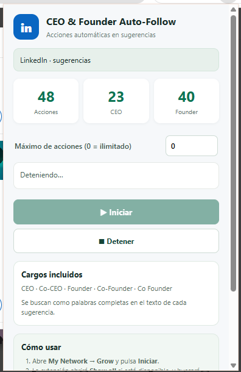

# LinkedIn CEO & Founder Auto-Follow

Chrome extension that helps you discover and follow or connect with executives in LinkedIn's **My Network → Grow** suggestions. It looks for profiles whose visible card text includes **CEO**, **Co-CEO**, **Founder**, **Co-Founder**, or **Co Founder**, then clicks the available **Follow** or **Connect** button.

> Independent community project. Not affiliated with, endorsed by, or sponsored by LinkedIn.

## Download and install

[⬇ **Download the extension (ZIP)**](https://github.com/sebastianbocek/linkedin-ceo-founder-auto-follow-chrome-extension/archive/refs/heads/main.zip)

1. Download and extract the ZIP file.
2. Open `chrome://extensions/` in Chrome and turn on **Developer mode**.
3. Click **Load unpacked** and select the extracted extension folder containing `manifest.json`.
4. Open [LinkedIn My Network → Grow](https://www.linkedin.com/mynetwork/grow/), open the extension, set the action limit, and click **Start**.

## Preview

## Features

- Opens the **Show all** suggestions view when that control is available.
- Searches visible suggestion cards for CEO and Founder title variants.
- Clicks the available **Follow** or **Connect** action on matching cards.
- Scrolls the suggestions dialog to load more profiles.
- Lets you set an action limit; enter `0` for unlimited processing.
- Shows action, CEO, and Founder counters, with a **Stop** control.
- Detects LinkedIn's weekly connection invitation limit notice and stops automatically.
- Does not add a note or submit any follow-up dialog. If LinkedIn opens an invitation confirmation, review and complete it yourself.

## Install in Chrome

1. Download this repository using **Code → Download ZIP**, then extract it.
2. Open `chrome://extensions/` and enable **Developer mode**.
3. Select **Load unpacked** and choose the extracted extension folder (the one containing `manifest.json`).
4. Sign in to LinkedIn and open [My Network → Grow](https://www.linkedin.com/mynetwork/grow/).
5. Open the extension, choose a maximum number of actions (`0` means unlimited), and select **Start**. Select **Stop** to end the run.

## Recognized titles

The extension matches these title terms in the suggestion card text:

- CEO and Co-CEO
- Founder, Co-Founder, and Co Founder

## Permissions

The extension uses `activeTab` and `scripting` to interact with the active LinkedIn tab after you start it. It does not collect or upload profile information.

## Important

This tool automates clicks on LinkedIn's interface. Use it thoughtfully, review each invitation flow, and follow LinkedIn's current terms and policies. LinkedIn may change its interface, which can affect the extension.

## Español

Extensión de Chrome para encontrar directivos en las sugerencias de [My Network → Grow](https://www.linkedin.com/mynetwork/grow/) de LinkedIn. Detecta los cargos **CEO**, **Co-CEO**, **Founder**, **Co-Founder** y **Co Founder**, y pulsa **Follow** o **Connect** cuando aparecen en una tarjeta coincidente.

- Abre **Show all** cuando está disponible y desplaza la lista dentro del diálogo de sugerencias.
- Permite definir un máximo de acciones; `0` significa ilimitado.
- Muestra contadores de acciones, CEO y Founder, y permite detener el proceso.
- Detecta el aviso de límite semanal de invitaciones de LinkedIn y detiene la automatización.
- Si **Connect** abre una confirmación de invitación, la extensión no agrega una nota ni la envía automáticamente: revisa y completa ese paso manualmente.

Para instalarla, descarga y extrae el ZIP, abre `chrome://extensions/`, activa **Modo desarrollador**, pulsa **Cargar descomprimida** y selecciona la carpeta que contiene `manifest.json`. Luego abre [My Network → Grow](https://www.linkedin.com/mynetwork/grow/), abre el popup e inicia el proceso.
